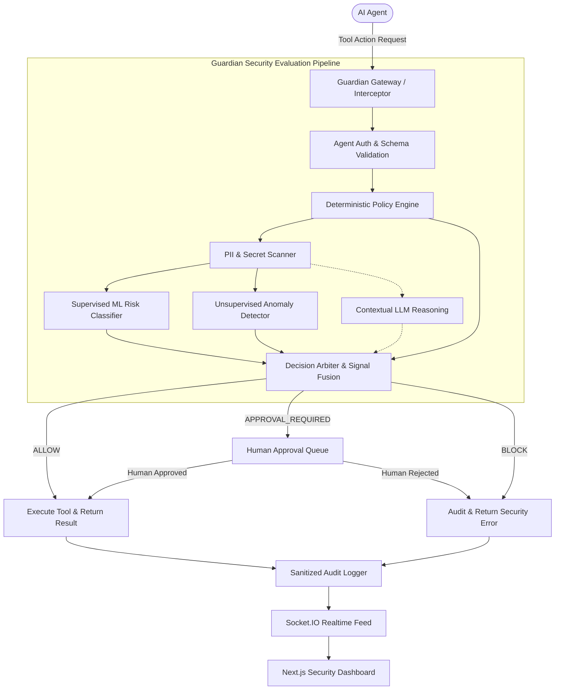

# Guardian Agent 2.0 — System Architecture Document

## 1. System Overview
Guardian Agent 2.0 is a runtime security gateway and governance platform for autonomous AI agents. It intercepts every proposed tool/API action before execution, enforces deterministic security policies, detects sensitive information (PII/secrets), predicts risk levels with a trained multiclass ML model, flags anomalous behavioral spikes with an unsupervised anomaly detector (Isolation Forest), performs optional LLM contextual risk explanation, and arbitrates final decisions (`ALLOW`, `APPROVAL_REQUIRED`, `BLOCK`).



## 2. Signal Hierarchy & Authority
To avoid reliance on probabilistic outputs as sole security boundaries:
1. **Hard Security Policy (Deterministic Rules)**: Highest authority. Can immediately force `BLOCK`. Cannot be overridden by ML or LLM.
2. **Tool Permission & Destination Allow-List**: Mandatory hard control. Non-whitelisted destinations or unregistered tools are rejected.
3. **Sensitive-Data Detector**: Deterministic regex & pattern detection. Redacts audit logs and can enforce approval or block on sensitive data.
4. **ML Risk Classifier (Supervised Multiclass)**: Predicts risk probabilities across `LOW`, `MEDIUM`, `HIGH`, `CRITICAL`.
5. **Anomaly Detector (Unsupervised Isolation Forest)**: Measures behavioral deviations from per-agent baselines (volume, frequency, destinations).
6. **LLM Contextual Security Analysis**: Advisory context & explainability; never a hard security override.
7. **Human Approval Workflow**: Required for actions flagged as `APPROVAL_REQUIRED` or `HIGH` risk escalation.

## 3. Directory Layout
```
guardian_agent/
├── backend/                  # Node.js/Express Guardian Gateway & API
│   ├── src/
│   │   ├── config/           # Database, env, logger config
│   │   ├── controllers/      # Route controllers
│   │   ├── middleware/       # Auth, RBAC, error handling, validation
│   │   ├── models/           # Mongoose schemas (users, agents, tools, policies, audits, etc.)
│   │   ├── routes/           # REST endpoints
│   │   ├── services/
│   │   │   ├── guardian/     # Core evaluation & execution gate
│   │   │   ├── policy/       # Deterministic policy engine
│   │   │   ├── risk/         # ML client & risk scoring
│   │   │   ├── pii/          # PII/Secret detection & redaction
│   │   │   ├── anomaly/      # Behavioral anomaly client
│   │   │   ├── llm/          # LLM contextual explanation client
│   │   │   ├── approval/     # Human approval queue & one-time tokens
│   │   │   └── audit/        # Sanitized tamper-resistant audit logger
│   │   ├── tools/            # Safe mock tools (Weather, DB, Email, Shell)
│   │   └── server.js         # Entrypoint with Express + Socket.IO
│   └── package.json
├── frontend/                 # Next.js 14+ / React Dashboard
│   ├── src/
│   │   ├── app/              # App router pages (Overview, Approvals, Policies, Agents, Simulator)
│   │   ├── components/       # Modern UI components, charts, live feed
│   │   └── lib/              # API clients & socket listeners
├── ml/                       # Standalone Python ML Pipeline & Service
│   ├── data/                 # Datasets (train, val, test)
│   ├── models/               # Serialized models & metadata
│   ├── notebooks/            # Exploratory analysis
│   ├── src/
│   │   ├── preprocess.py     # Feature engineering & encoding
│   │   ├── train.py          # Baseline Logistic Reg, Random Forest, XGBoost
│   │   ├── evaluate.py       # Confusion matrices, F1, PR-AUC, metrics
│   │   ├── anomaly.py        # Isolation Forest baseline training
│   │   └── app.py            # FastAPI ML Inference Server (port 8000)
│   └── requirements.txt
├── simulator/                # 8+ Security & Attack simulation test suites
├── docs/                     # Architectural, Threat Model, and API specs
└── .env.example
```
